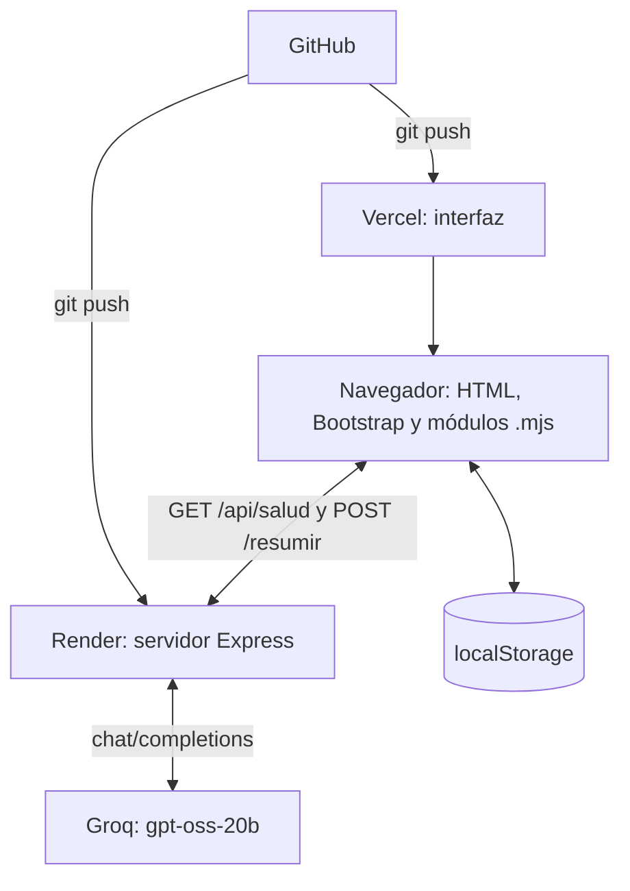

# Resumidor de Textos con Inteligencia Artificial

Aplicación web que resume textos largos con un modelo de inteligencia artificial. La persona pega un texto, elige un resumen corto, mediano o largo, y ve cómo el resumen se va escribiendo en pantalla. Proyecto del segundo corte, UNISANGIL.

## Enlaces

- Aplicación publicada (Vercel): https://resumidor-iota.vercel.app
- Servidor (Render): https://resumidor-ge5f.onrender.com
- Repositorio: https://github.com/charithlopez/Resumidor

> El servidor usa el plan gratuito de Render, que se duerme cuando nadie lo usa. La primera consulta del día puede tardar hasta un minuto.

## Qué hace

- Resume textos en tres longitudes: corto, mediano y largo.
- Muestra el resumen en tiempo real, mientras se genera.
- Guarda en el navegador el tema (claro u oscuro) y los últimos 10 resúmenes, con opción de borrarlos.
- Se adapta a celular, tableta y computador.
- Se puede usar con teclado, con foco visible y contraste medido.

## Arquitectura



| Pieza | Tecnología | Dónde está publicada |
|---|---|---|
| Interfaz | HTML, Bootstrap 5.3.8 y JavaScript en módulos `.mjs` | Vercel |
| Servidor | Node.js y Express | Render |
| Inteligencia artificial | Servicio externo Groq, modelo `openai/gpt-oss-20b` (formato compatible con OpenAI) | Servicio externo |
| Almacenamiento | `localStorage` del navegador | En el navegador de cada persona |

El modelo de inteligencia artificial no es propio: el servidor lo consulta con una clave que vive en variables de entorno.

## Estructura del proyecto

```
server.js              Servidor Express: rutas, validación y conexión con la IA
package.json           Dependencias y scripts
.gitignore             Excluye node_modules y .env
public/
  index.html           Página principal
  styles.css           Estilos propios (fuente)
  styles.min.css       Estilos minificados (generado)
  js/                  Módulos fuente
    config.mjs           Direcciones y constantes
    elementos.mjs        Elementos de la página
    utilidades.mjs       Contar palabras y dar formato a fechas
    almacenamiento.mjs   localStorage y el historial
    api.mjs              Conexión con el servidor (fetch y streaming)
    interfaz.mjs         Avisos, tema e historial en pantalla
    main.mjs             Eventos y orden general
  min/                 Módulos minificados (generados)
```

## Rutas del servidor

| Método | Ruta | Qué hace |
|---|---|---|
| GET | `/api/salud` | Comprueba que el servidor responde. Devuelve JSON con el estado y el modelo |
| POST | `/resumir` | Recibe `{ texto, longitud }` y devuelve el resumen como texto, poco a poco (streaming) |

Los errores responden JSON con códigos HTTP: 400 (petición inválida), 404 (ruta `/api` que no existe), 413 (texto demasiado largo), 429 (ya hay un resumen en proceso o el servicio de IA está ocupado), 500 (servidor sin configurar), 502 y 503 (problemas con el servicio de IA).

## Cómo ejecutarlo en tu computador

Necesitas Node.js 18 o superior y una clave gratuita del servicio de IA (console.groq.com).

1. Descarga el proyecto e instala las dependencias:

```
git clone https://github.com/charithlopez/Resumidor.git
cd Resumidor
npm install
```

2. Crea un archivo `.env` en la carpeta principal (este archivo no se sube a GitHub):

```
PORT=3000
IA_URL=https://api.groq.com/openai/v1/chat/completions
IA_MODELO=openai/gpt-oss-20b
IA_CLAVE=tu_clave_aqui
ORIGENES_PERMITIDOS=http://localhost:3000
```

3. Arranca el servidor:

```
npm start
```

4. Abre http://localhost:3000 en el navegador.

### Variables de entorno

| Variable | Para qué sirve |
|---|---|
| `PORT` | Puerto del servidor (en Render lo asigna la plataforma) |
| `IA_URL` | Dirección del servicio de IA |
| `IA_MODELO` | Modelo que genera el resumen |
| `IA_CLAVE` | Clave del servicio de IA (secreta, nunca va en el código ni en GitHub) |
| `ORIGENES_PERMITIDOS` | Direcciones autorizadas por CORS, separadas por coma y sin `/` al final |

### Scripts

| Comando | Qué hace |
|---|---|
| `npm start` | Arranca el servidor |
| `npm run build` | Genera los archivos minificados de `public/min` y `public/styles.min.css` con esbuild |

Cada vez que cambies algo en `public/js` o `public/styles.css`, ejecuta `npm run build` y sube también los archivos generados.

## Cómo se hizo: decisiones técnicas

- **JavaScript moderno y módulos.** El código está dividido en siete módulos `.mjs` con una sola responsabilidad cada uno, conectados con `export` e `import`. Se usa `let` y `const`, y siempre `===`.
- **Delegación de eventos.** Un solo listener en el contenedor atiende los botones de longitud, y otro atiende los botones del historial (que se crean dinámicamente), usando `evento.target.closest(...)`.
- **Conexión cliente-servidor.** `fetch` con `async` y `await`, revisión de `response.ok` y `try/catch` con mensajes claros. La respuesta se lee por trozos con `getReader`. La dirección del servidor está en un solo lugar (`config.mjs`) y cambia sola entre local y producción.
- **Seguridad.** El texto dinámico se escribe con `textContent` y `createElement`, nunca con `innerHTML` (prevención de XSS). El servidor valida el texto y la longitud de cada petición. CORS solo permite las direcciones indicadas en `ORIGENES_PERMITIDOS`. La clave de la IA vive en variables de entorno, fuera del código y del repositorio.
- **Persistencia.** `localStorage` guarda el tema y el historial con `JSON.stringify` y `JSON.parse`. Se maneja la primera visita (sin datos), no se guarda el texto original y hay botones para borrar. No se usa `sessionStorage` porque no hay datos que deban olvidarse al cerrar la pestaña.
- **Bootstrap.** Versión 5.3.8 fija por CDN, cuadrícula `container`, `row` y `col` con prefijos, componentes y utilidades, y tema claro y oscuro con `data-bs-theme`.
- **Experiencia de usuario y accesibilidad.** Avisos de éxito y error con texto (no solo color), estado de carga en el botón, contraste de al menos 4.5 a 1 medido en los dos temas, foco visible con teclado, etiquetas ligadas a los campos y `aria-pressed` actualizado en los botones de longitud.

## Optimización y resultados

### Compresión

El servidor comprime sus respuestas con gzip (paquete `compression`). La ruta `/resumir` se excluye a propósito, porque envía el resumen poco a poco y comprimirla retrasaría los trozos.

### Minificación

Se minifican el JavaScript y el CSS con esbuild (`npm run build`):

| Archivos | Antes | Después | Ahorro |
|---|---|---|---|
| JavaScript (7 módulos) | 15.550 bytes | 8.549 bytes | 45 % |
| CSS | 4.593 bytes | 3.388 bytes | 26 % |
| Total | 20.143 bytes | 11.937 bytes | 41 % |

No se aplicó `lazy loading` porque la página no tiene imágenes.

### Lighthouse

Medido sobre la aplicación publicada en Vercel:

| Categoría | Móvil (claro y oscuro) | Escritorio, claro | Escritorio, oscuro |
|---|---|---|---|
| Rendimiento | 99 | 96 | 97 |
| Accesibilidad | 100 | 100 | 100 |
| Buenas prácticas | 100 | 100 | 100 |
| SEO | 90 | 90 | 90 |

SEO quedó en 90 en todas las mediciones. Todas las categorías superan la meta de 90.

## Despliegue

- **Servidor (Render):** Build Command `npm install`, Start Command `npm start`, y las variables de entorno escritas en el panel de Render. Cada `git push` lo vuelve a publicar.
- **Interfaz (Vercel):** Framework Preset `Other`, sin comando de build y Output Directory `public`. Los archivos minificados ya están en el repositorio.

## Privacidad

El tema y el historial se guardan solo en el navegador de quien usa la página. El historial guarda los resúmenes, no el texto original. El botón "Olvidar mis datos" los borra. Para resumir, el texto que se pega se envía a un servicio de inteligencia artificial externo, por lo que no se debe pegar información privada.

## Limitaciones

- Atiende un resumen a la vez.
- El servidor gratuito se duerme y puede tardar hasta un minuto en responder la primera vez.
- Depende de los límites del plan gratuito del servicio de IA.
